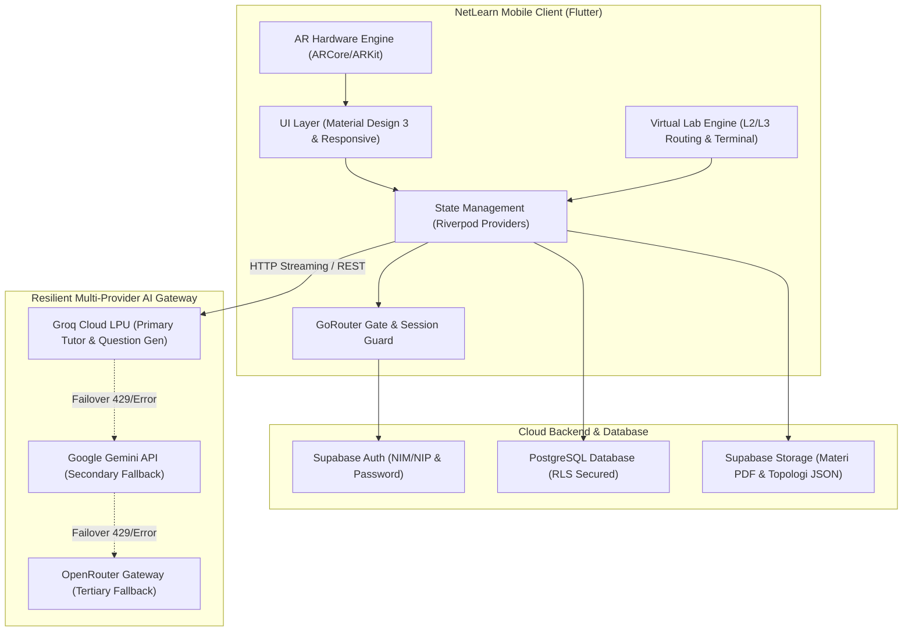

# NetLearn — Media Pembelajaran Interaktif Jaringan Komputer Berbasis AR & AI

[](https://flutter.dev)
[](https://supabase.com)
[](LICENSE)

---

## 1. Informasi Tim
* **Nama Tim**: `Soto Tanpa Kecap`
* **Daftar Anggota Tim**:
  1. `Rafi Ahmad Fauzan` — Peran/Role : Lead Developer / Backend Developer
  2. `Rendy Aditya Pratama` — Peran/Role : UI/UX Designer / Frontend Developer


---

## 2. Ringkasan Proyek & Produk
* Kategori: Mobile (Android)
* Nama Aplikasi: NetLearn
* Target Pengguna: 
  * Mahasiswa yang mempelajari mata kuliah/bidang Jaringan Komputer (Computer Networking).
  * Dosen/Instruktur Jaringan Komputer.

* **Permasalahan yang Diangkat**:
  * Konsep jaringan komputer (topologi, model OSI, packet routing, dan subnetting) bersifat abstrak dan sulit divisualisasikan secara nyata tanpa perangkat laboratorium fisik yang mahal.
  * Mahasiswa sering mengalami kebosanan atau keterbatasan akses simulator jaringan desktop saat belajar secara mandiri.
  * Dosen membutuhkan alat otomatisasi evaluasi dan pendampingan pembelajaran berbasis AI yang adaptif untuk mengukur performa belajar mahasiswa.

* **Deskripsi Solusi**:
  * NetLearn adalah aplikasi *edutech mobile* komprehensif yang mengintegrasikan Augmented Reality (AR) untuk visualisasi perangkat jaringan 3D, Virtual Lab Simulator (Layer 2 & Layer 3) dengan engine terminal interaktif (Ping, Tracert, IPConfig), modul latihan intensif Subnet Drill, serta asisten tutor cerdas NetBot AI dan fitur AI Dosen multi-provider untuk evaluasi pembelajaran otomatis.

---

## 3. Fitur Utama yang Diimplementasikan

### A. Mahasiswa (Student Experience)
1. **Virtual Lab Simulator (Layer 2 & Layer 3)**:
   * Simulator kanvas interaktif untuk menyusun topologi perangkat (PC, Switch, Router, Server).
   * Konfigurasi IP, Gateway, dan Subnet Mask secara dinamis.
   * Layanan jaringan: DHCP Server dan HTTP Web Server bawaan.
   * Terminal Console CLI Engine: Menjalankan perintah jaringan riil (`ping`, `tracert`, `ipconfig`, `help`).

   * **Automated Mission Checker**: Sistem evaluasi misi praktikum otomatis dengan skor objektif.
   * Ekspor topologi ke format JSON dan gambar diagram PNG (dapat disimpan langsung ke galeri).

2. **Augmented Reality (AR) Hardware Viewer**:
   * Visualisasi interaktif model 3D perangkat jaringan komputer (Router, Switch, Server, Kabel UTP) secara imersif menggunakan kamera ponsel.
3. **Subnet Drill & Gamified Challenge**:
   * Latihan perhitungan subnetting IPv4 interaktif dengan limit waktu (timed drill).
   * Papan peringkat kelas (Leaderboard) untuk memacu motivasi belajar.
4. **Modul Materi Pembelajaran & Video Interaktif**:
   * Pembaca materi terstruktur, panduan praktikum, dokumen manual book PDF, dan video pembelajaran YouTube terintegrasi.
5. **NetBot AI Tutor (Bilingual & Multi-Provider)**:
   * Asisten tanya-jawab konsep jaringan dengan pemahaman konteks modul dan kondisi topologi kanvas.
   * Format teks bersih, bebas simbol berlebih, dan nyaman dibaca mahasiswa.

### B. Dosen (Lecturer Experience)
1. **AI Question Generator & Quiz Creator**:
   * Pembuatan paket kuis otomatis berbasis AI berdasarkan topik atau modul tertentu.
2. **AI Pedagogical Insight & Analytics**:
   * Evaluasi performa kelas dan analisis diagnostik nilai Pretest/Posttest secara instan.
3. **Bilingual Translation Engine**:
   * Penerjemahan materi ajar dan paket soal kuis (Indonesia ↔ English) dengan failover AI.
4. **Manajemen Kelas & Rekap Nilai**:
   * Manajemen modul ajar, penugasan, forum diskusi, serta ekspor rekapitulasi nilai ke format CSV dan PDF.

### C. Fitur AI yang Diimplementasikan di Aplikasi
1. **NetBot (AI Tutor Interaktif Mahasiswa)**: Pendamping belajar 24 jam yang memahami konteks modul materi dan kondisi topologi kanvas Virtual Lab secara *real-time*, dilengkapi sanitasi teks otomatis agar hasil respon bersih dan nyaman dibaca.
2. **AI Question Generator (Dosen)**: Pembuat butir soal kuis pilihan ganda otomatis beserta kunci jawaban dan opsi pengecoh adaptif berdasarkan topik/modul tertentu.
3. **AI Pedagogical Insight & Analytics (Dosen)**: Analisis diagnostik performa kelas berdasarkan komparasi nilai Pretest vs Posttest mahasiswa dengan rekomendasi bimbingan pedagogis otomatis.
4. **Bilingual Translation Engine**: Penerjemah materi ajar dan paket soal kuis (Indonesia ↔ English) secara akurat dengan mekanisme *resilient failover multi-provider*.

---

## 4. Teknologi yang Digunakan
* **Framework**: [Flutter](https://flutter.dev/) (Dart SDK `^3.13.2`)
* **State Management & Routing**: 
  * `flutter_riverpod` (`^3.4.3`)
  * `go_router` (`^18.0.2`)
* **Backend, Database & Autentikasi**:
  * [Supabase](https://supabase.com/) (`supabase_flutter: ^2.17.2`) — PostgreSQL Database, Auth, Realtime, Row Level Security (RLS), & Cloud Storage.
* **Environment Variable Management**:
  * `flutter_dotenv` (`^6.0.1`)
* **Augmented Reality & Media**:
  * `ar_flutter_plugin_plus` (`^1.1.3`)
  * `youtube_player_iframe` (`^6.0.2`)
  * `pdfx` (`^2.6.0`) & `pdf` (`^3.13.1`)
  * `audioplayers` (`^6.8.1`)
* **Speech & Audio**:
  * `speech_to_text` (`^7.5.0`)
* **Artificial Intelligence (Multi-Provider AI Gateway)**:
  * **Groq LPU API**: Akses model inferensi berlatensi sangat rendah (<1 detik) untuk respons interaktif `openai/gpt-oss-20b`, `openai/gpt-oss-120b`, `qwen/qwen3.8-27b`, `allam-2-7b`.
  * **Google Gemini API**: `google_generative_ai` (`^0.4.7`) untuk penalaran materi edukasi yang mendalam. Model yang digunakan: `gemini-2.5-flash` dan `gemini-2.5-flash-lite`.
  * **OpenRouter API**: Failover provider pihak ketiga guna menjamin *high availability* (anti rate-limit/429). Model yang digunakan: `nvidia/nemotron-3.5-lightning:free`, `google/gemma-4-31b-it:free`, `nvidia/nemotron-3-nano-omni-30b-a3b-reasoning:free`, `liquid/lfm-2.5-2.6b:free`.

---

## 5. Diagram Arsitektur Sistem & Alur Data



### Alur Data (Data Flow):
1. **Autentikasi**: Mahasiswa/Dosen login menggunakan NIM/NIP. Client memvalidasi kredensial ke Supabase Auth, lalu `GoRouter` mengarahkan ke dashboard yang sesuai berdasarkan peran (role-based redirect).
2. **Virtual Lab Simulation**: Topologi, koneksi kabel, dan konfigurasi IP diproses secara lokal di state memori perangkat. Saat mahasiswa menyelesaikan misi, sistem memvalidasi tabel routing dan konektivitas via Terminal CLI Engine, kemudian mengunggah skor capaian ke Supabase.
3. **AI Assistance (NetBot & Dosen)**: Pertanyaan dikirim bersama konteks modul aktif ke AI Gateway. Gateway secara cerdas memilih provider prioritas (Groq) dan otomatis beralih ke Gemini/OpenRouter jika terjadi batasan kuota (rate-limit).

---

## 6. Panduan Instalasi & Menjalankan Aplikasi

### A. Prasyarat Sistem
* [Flutter SDK](https://docs.flutter.dev/get-started/install) (versi minimal `3.13.2` atau lebih baru).
* [Android Studio](https://developer.android.com/studio) dengan Android SDK & Emulator (Android 8.0 / API Level 26+ disarankan untuk dukungan ARCore).
* Git terpasang di sistem.

### B. Langkah Instalasi
## Menggunakan Flutter run:
1. **Clone Repositori**:
   ```bash
   git clone https://github.com/SuponoNotoBoto/Netlearn-Mobile-App
   cd Netlearn-Mobile-App
   ```

2. **Pasang Dependensi**:
   ```bash
   flutter pub get
   ```

3. **Jalankan Aplikasi**:
   * Jalankan di perangkat Android / Emulator:
     ```bash
     flutter run
     ```
   * Jalankan di browser Google Chrome (Web Preview):
     ```bash
     flutter run -d chrome
     ```

4. **Menjalankan Pengujian Otomatis (Automated Tests)**:
   ```bash
   flutter test
   ```

## Download melalui APK di Google Drive 
1. Download apk:
   https://drive.google.com/drive/folders/12NiKwvon71Nd-3GMC3kWYz6JOoPffi-8

2. Install apk:
   Install APK dan jalankan pada perangkat android.
   
---

## 7. Akun Demonstrasi (Demo Accounts)

Berikut akun yang dapat digunakan:

| Peran (Role) | Nomor Identitas (NIM / NIP) | Password | Keterangan Akses |
| :--- | :--- | :--- | :--- |
| **Mahasiswa** | `[MASUKKAN NIM MAHASISWA DEMO]` | `[MASUKKAN PASSWORD]` | Akses Virtual Lab, AR, Subnet Drill, Materi, NetBot AI. |
| **Dosen** | `[MASUKKAN NIP DOSEN DEMO]` | `[MASUKKAN PASSWORD]` | Akses Buat Kuis AI, Analisis Nilai AI, Rekap Nilai, Kelola Kelas. |

---

## 8. Dokumentasi Penggunaan AI dalam Pengerjaan Proyek

Dalam proses riset, perancangan arsitektur, penulisan kode, penjaminan kualitas (*testing*), hingga penyusunan dokumentasi proyek NetLearn, tim pengembang memanfaatkan alat bantu kecerdasan buatan (*AI-assisted development tools*) sebagai akselerator:

1. **Google Antigravity**:
   * **Perancangan Arsitektur & Resilience Engine**: Membantu merancang arsitektur multi-provider AI resilience (mekanisme failover berjenjang Groq → Google Gemini → OpenRouter) serta sistem navigasi berbasis *route guards* pada GoRouter.
   * **Pengujian & Verifikasi Kualitas Otomatis**: Menjalankan analisis statis (*linter* dan `flutter analyze`), otomatisasi pengujian unit dan widget (`flutter test`), serta refactoring penanganan sanitasi teks NetBot dan migrasi keamanan variabel lingkungan (`.env` via `flutter_dotenv`).
   * **Standardisasi Kode & Dokumentasi**: Mengotomatisasi penyeragaman dokumentasi komentar kode sumber pada 14 berkas arsitektur inti.

2. **OpenCode**:
   * **Akselerasi Coding & Prototyping Widget**: Membantu pembuatan *boilerplate* antarmuka (UI/UX) berbasis Flutter Material 3, komponen widget kustom, model data Dart, serta *state controller* Riverpod.
   * **Penyusunan Logika Algoritma**: Membantu formulasi logika kalkulasi subnetting pada modul Subnet Drill dan struktur parsing perintah terminal simulator di Virtual Lab.
   * **Efisiensi Debugging**: Mempercepat pelacakan kendala rendering layout dan optimasi performa widget.

3. **Gemini** :
    * **Pembuatan Marker AR** : Menggunakan gemini generate image untuk membuat marker AR. 

---

## 9. Atribusi Sumber, Aset, & Pihak Ketiga

Seluruh aset, pustaka, dan layanan pihak ketiga yang digunakan dalam pengembangan NetLearn:
* **Framework & Bahasa**: [Flutter](https://flutter.dev/) & [Dart](https://dart.dev/) oleh Google.
* **Backend as a Service**: [Supabase](https://supabase.com/) (Open Source Firebase Alternative).
* **UI/UX Reference**: (https://www.behance.net/gallery/252268691/Education-Management-Mobile-App-Redesign)
* **Font Typography**:
  * *Plus Jakarta Sans* oleh Tokotype (Google Fonts, Open Font License).
  * *Inter* oleh Rasmus Andersson (SIL Open Font License).
  * *DM Sans* oleh Colophon Foundry (SIL Open Font License).
* **Ikon Antarmuka**:
  * `CupertinoIcons` & Flutter Material Symbols / Icons.
* **Efek Suara (Audio SFX)**:
  * Sound effects interaksi (connect, error, pop, success) bersumber dari lisensi bebas royalti (Creative Commons Zero / Freesound).
  * **Voice Over AR**: 
    *Menggunakan Voice Over AI di ClipChamp
* **Model 3D AR & Marker**:
  * Switch : (https://skfb.ly/6ZGYp)
  * PC : (https://skfb.ly/6WKZ9)
  * Hub : Dibuat 3D menggunakan Meshy AI dari referensi gambar (https://www.uninets.com/blog/hub-in-networking)
  * Wireless Router : (https://skfb.ly/o6pIQ)
  * PC full setup : (https://skfb.ly/p8LB8)
  * Topologi Star : Dibuat menggunakan Blender dengan 3D model dari sketchfab.
  * Jaringan 2 PC dan 1 Switch : Dibuat menggunakan Blender dengan 3D model dari sketchfab.
  * Markers : Dibuat menggunakan gemini generate image.

* **Layanan AI**:
  * [Groq Inc.](https://groq.com/) untuk LPU Inference Engine.
  * [Google AI for Developers](https://ai.google.dev/) untuk Gemini API.
  * [OpenRouter](https://openrouter.ai/) untuk Unified LLM Gateway.